  

 

### About

- Studying **Electronics and Telecommunications Engineering** at **VNU-HCMUS** (University of Science, Ho Chi Minh City).
- Working across low-level firmware (**ESP32**, **STM32**, **C/C++**, **Assembly**) and systems software (**Rust**, **Linux**).
- Building developer tooling, static/runtime code analysis engines, **Model Context Protocol (MCP)** SDKs, and local **RAG** pipelines.

---

### Tech Stack

**Systems, Hardware & Embedded**  

**Software, Web & Backend**  

**AI, Data & Infrastructure**  

---

### Projects

<table align="center">
  <tr>
    <td align="center" width="50%">
      <a href="https://github.com/ptai-eng/chronos-agent">
        
         
        <b>chronos-agent</b>
      </a>
    </td>
    <td align="center" width="50%">
      <a href="https://github.com/ptai-eng/synapse-mcp">
        
         
        <b>synapse-mcp</b>
      </a>
    </td>
  </tr>
  <tr>
    <td>Code graph and blast-radius analysis engine written in Rust. Pairs AST indexing, KuzuDB, V8 runtime coverage, and mutation testing across 12 MCP tools.</td>
    <td>Header-only C++23 SDK for the Model Context Protocol. Handles JSON-RPC 2.0 transport over stdio and IPC without external runtime dependencies.</td>
  </tr>
  <tr>
    <td align="center" width="50%">
      <a href="https://github.com/ptai-eng/GoldPan">
        
         
        <b>GoldPan</b>
      </a>
    </td>
    <td align="center" width="50%">
      <a href="https://github.com/ptai-eng/OpenSerial-Studio">
        
         
        <b>OpenSerial-Studio</b>
      </a>
    </td>
  </tr>
  <tr>
    <td>Local document extraction and RAG workspace. Converts PDFs, audio, images, and web pages into Markdown backed by local ChromaDB vector storage.</td>
    <td>Web Serial & MCP hardware telemetry workstation. Features Radix-2 FFT spectral metrology, IEEE-1057 sine fitting, 64-core RISC-V GPU framebuffer visualization, and 4-platform firmware codegen.</td>
  </tr>
</table>

 

### Competitions

  <a href="https://github.com/ngtanphat-hcmus/GDGoC_AI_Challenge_26">
    
     
    <b>GDGoC AI Challenge 2026</b>
  </a>

 

---

  
<b>phattai09052006@gmail.com</b> • <b>24207039@student.hcmus.edu.vn</b>

  
  

